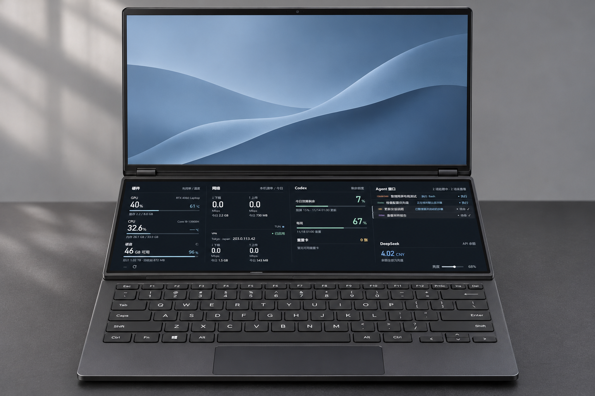
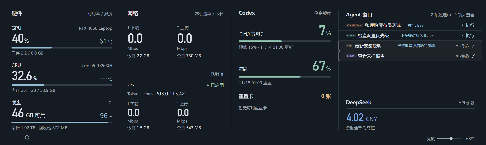
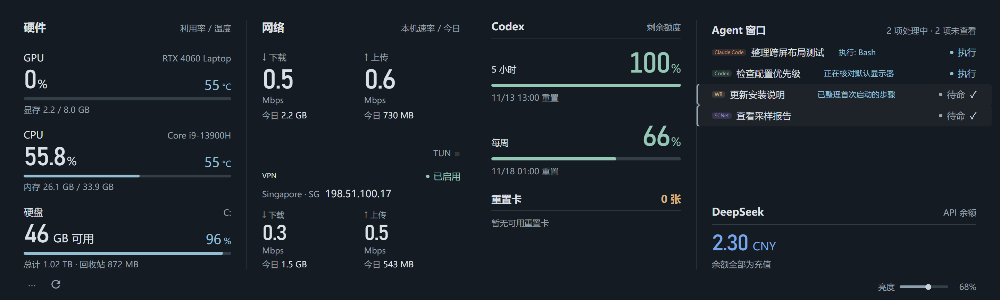

# Side Screen Panel · 副屏看板

专为键盘上方带横向副屏的 Windows 双屏笔记本设计，例如搭载 ScreenPad Plus 的 ASUS Zenbook Duo 14。主屏继续用来工作，副屏常驻硬件占用、网络速率、Codex 额度和 Agent 会话状态。也支持扩展桌面模式下的外接副屏。[ASUS 机型示例](https://www.asus.com/laptops/for-creators/zenbook/zenbook-duo-14-ux482/)

[下载 Windows x64 版](https://github.com/rhouselyn/side-screen-panel/releases/latest/download/Side-Screen-Panel-windows-x64.zip) · [查看更新记录](https://github.com/rhouselyn/side-screen-panel/releases)



*双屏笔记本使用效果图，由 AI 生成，副屏参考下方的 Pro 看板预览。*

## 快速开始

1. 下载并解压 ZIP 到一个固定目录。支持 Windows 10 和 11 的 x64 电脑。
2. 双击 **Start Panel.cmd**。首次联网启动会下载并校验 Python 运行环境和依赖。无需管理员权限，也无需预装 Python。之后可离线启动，联网集成仍需要网络。
3. 看板默认显示在副屏。多块副屏或选错屏幕时，右键 Windows 托盘中的看板图标，打开 **显示器** 菜单并选择目标屏幕。

看板会记住所选显示器。副屏短暂断开时先隐藏，重新接入后恢复。可以从看板左下角 **⋯ → 开机自动启动** 设置登录后启动。如果移动了解压目录，重新启动后再切换一次开机启动以更新快捷方式。

## 预览

### Codex Pro · 每日预算与每周额度

每日预算由看板根据周额度分配，是本地估算。支持读取账户返回的重置卡数量和到期时间。



### Codex Plus · 五小时窗口与每周额度

Plus 显示 Codex 返回的使用窗口和重置时间。两张图都使用演示数据。



## 数据来源

| 模块 | 数据来源 |
| --- | --- |
| 硬件 | Windows 的 CPU、内存、系统盘和回收站。NVIDIA 指标使用 `nvidia-smi`。CPU 温度取自可用的 WMI 传感器，例如 LibreHardwareMonitor 提供的传感器。 |
| 网络与 TUN | 本机网卡速率和当日累计流量。VPN 区读取 Clash Verge Rev 的本机控制器。TUN 切换成功后保存偏好，并在看板重启时恢复。出口 IP 和地区由外部查询服务提供。 |
| Codex 额度 | 本机已登录的 Codex CLI 或桌面版内置 CLI，通过 App Server 读取。 |
| Agent 会话 | 读取本机 Codex、Claude Code、ZCode、WorkBuddy、SCNet 的会话文件。支持来源标签、执行状态和未查看提醒。跨应用跳转取决于各客户端提供的入口。 |
| Claude Code | 自动查找 `~/.claude` 或 `CLAUDE_CONFIG_DIR`。显示本机可见的执行、待回复、完成及异常状态。点击有可用工作目录的会话，会通过 `claude --resume` 打开一个新终端。 |
| DeepSeek | 可在 **⋯** 菜单保存 DeepSeek API Key，或设置 `DEEPSEEK_API_KEY` 环境变量。余额由 DeepSeek API 返回。 |

可选集成未安装、未登录或没有数据时，相应区域显示占位。Claude Code 等客户端如果变更本地日志格式，部分状态可能显示为「未确认」。

## 本地数据

设置、缓存和诊断日志保存在 `%LOCALAPPDATA%\SideScreenPanel`。首次从早期工作区升级时会迁移原有的亮度、TUN、已读记录、额度和 API Key 设置。会话内容在本机读取并显示。DeepSeek Key 可以交给环境变量管理，也可以通过菜单保存在本机配置文件里。

卸载时，在看板里关闭开机启动，从托盘选择 **退出**，然后移除解压目录。若需要清除保存的偏好和已下载的运行环境，可移除上述本地数据目录。

## 从源码运行

在 Windows x64 上克隆仓库后可直接运行 **Start Panel.cmd**。已有 Python 3.11 时，也可以手动建立环境并运行。

```powershell
py -3.11 -m venv .venv
.\.venv\Scripts\python.exe -m pip install --require-hashes -r requirements.txt
.\.venv\Scripts\pythonw.exe panel_watchdog.py
```

修改布局后，从 `dashboard-demo.html` 重新生成运行页面，再运行测试。

```powershell
.\.venv\Scripts\python.exe build_dashboard.py
.\.venv\Scripts\python.exe -m unittest discover
```

## 许可证

[GPL-3.0](LICENSE)。界面使用 [PyQt5](https://www.riverbankcomputing.com/software/pyqt/)，首次启动通过 [uv](https://github.com/astral-sh/uv) 安装运行依赖。Codex、Claude Code 等各产品由各自的厂商提供。
